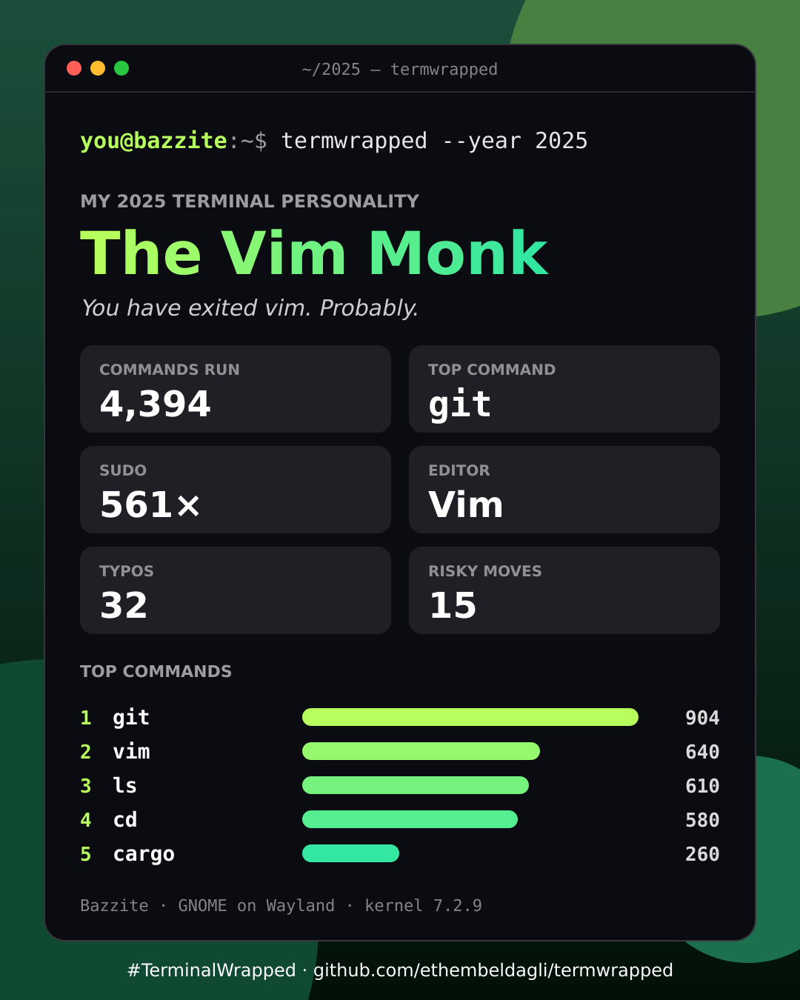

# Terminal Wrapped

[](https://github.com/ethembeldagli/termwrapped/actions/workflows/ci.yml)

**Spotify Wrapped, but for your Linux terminal.**



Run one command and get an animated year-in-review of your shell, git, packages
and games, plus your *terminal personality*, ending with a share card for
r/linux, r/unixporn or wherever you post.

```
$ termwrapped
```

- **Animated slideshow in the terminal**: full-screen gradients, pixel-font numbers, count-ups
- **Your terminal personality**: The Sudo Sorcerer, The Eternal Tinkerer, The Vim Monk, The Proton Pilgrim…
- **A 1080×1350 share card** (PNG/SVG), saved to `~/Pictures`
- **No dependencies.** Plain Python 3.9+ standard library
- **Nothing leaves your machine.** No network calls, no telemetry. Full command lines are never shown, only command *names* and counts

## What it looks at

| Source | What you get |
| --- | --- |
| bash / zsh / fish / [atuin](https://atuin.sh) history | total commands, top 5, sudo count, editor wars, typos (`gti`, `sl`, `claer`…), `:q` typed into bash, danger zone (`rm -rf`, `curl \| sh`, `chmod 777`, `git push --force`), AI tools, `fastfetch` flexing |
| git repos under `~` | your commits, lines +/-, streak, night & weekend commits, top language, "fix" / WIP / swear counts |
| apt, dnf/dnf5, pacman, zypper, flatpak | packages installed and removed this year |
| rpm-ostree / bootc / ujust | OS rebases, rollbacks, layered packages (Bazzite, Silverblue, Aurora, Bluefin…) |
| Steam, Heroic, Lutris | hours and top games |
| the machine | distro, desktop, kernel, distrobox/toolbox, uptime |

Anything missing is skipped quietly. Every machine gets a different set of slides.

## Works on

Any Linux with **Python 3.9+**. CI runs the tests on every push on
**Ubuntu, Debian, Fedora, Arch, openSUSE, Alpine** and Python 3.9.

- **Atomic/image-based distros** (Bazzite, Silverblue, Aurora, Bluefin, bootc): understood.
  rpm-ostree rebases and rollbacks count, and the image's own build history doesn't.
- **distrobox / toolbox**: run it inside a box and it still reads your host's distro and history.
- **Any shell**: bash, zsh, fish or atuin.
- **Any terminal**: truecolor where available, 256 colours otherwise, plain text on the Linux console or when piped.
- **WSL** should work too (untested). macOS and Windows are not supported.

## Install

```bash
pipx install git+https://github.com/ethembeldagli/termwrapped   # or:
python3 termwrapped.pyz                               # single file, from Releases
```

From a checkout: `python3 -m termwrapped`.

## Options

```
--year 2025          unwrap another year
--email me@x.com     count commits by this email (repeatable)
--repos ~/code       where to look for git repos
--name NAME          name on the card (default: your username), --anon for none
--card out.png       where to save the card (.png or .svg), --no-card to skip
--auto [SECONDS]     auto-advance the slides
--plain              plain text output (used automatically when piped)
--json               dump the raw stats
```

Keys: <kbd>space</kbd>/<kbd>→</kbd> next · <kbd>←</kbd> back · <kbd>q</kbd> quit.

## Better stats next year

Bash doesn't record *when* you ran things unless you ask it to. Add this to
`~/.bashrc` to unlock the "prime time" slide and year-accurate counts:

```bash
export HISTTIMEFORMAT='%F %T '
export HISTSIZE=100000 HISTFILESIZE=100000
```

zsh users: `setopt EXTENDED_HISTORY`. fish and atuin already record timestamps.

## PNG export

The card is always written as SVG. For a PNG, termwrapped uses the first one
it finds of `rsvg-convert`, `gdk-pixbuf-thumbnailer` (most GNOME desktops),
Inkscape, `ksvgtopng` (KDE), Chromium/Chrome, Firefox, or ImageMagick.

## Build the single-file release

```bash
./build.sh   # -> dist/termwrapped.pyz
```
